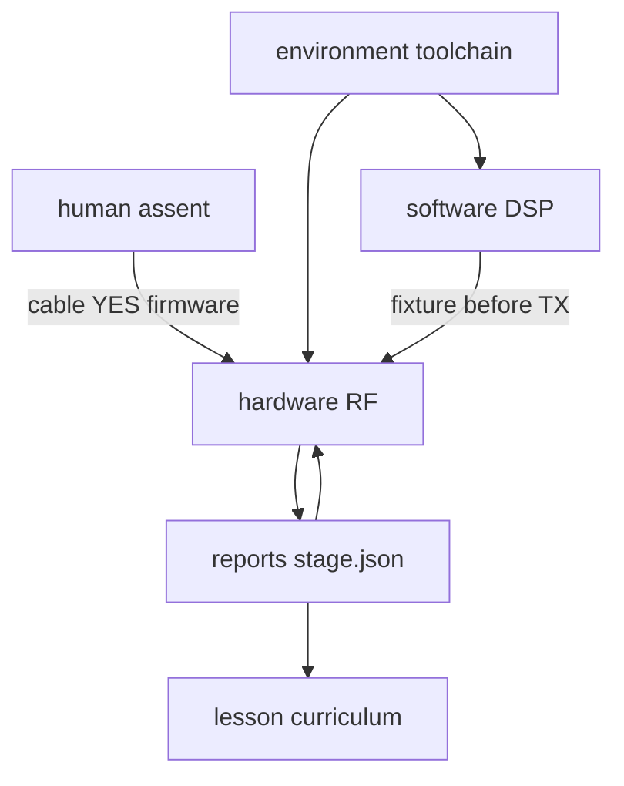

# rad-lab

Containerized SDR toolset structured by **role**. The general engineering method (evidence-gated roles, SIL→HWIL) is documented in [`docs/methodology/`](docs/methodology/README.md).

**Terminology:** **HWIL** = hardware-in-the-loop. **Human** / **human-in-the-loop** = operator (always spelled out). Assent flags are `HUMAN_*`.

Roles in this repo:

1. **[human/](human/)** — human-in-the-loop assent (`HUMAN_LOOPBACK`, `HUMAN_TX_CONFIRM`, `HUMAN_FIRMWARE`, type `YES`)
2. **[hardware/](hardware/)** — HWIL automation: stages, firmware, RF labs (`make stage` / `make hwil`)
3. **[software/](software/)** — offline DSP fixture and helpers (`make sim`, `make check`)
4. **[environment/](environment/)** — archive, container, `sdr_run` (`make image`, `make archive`)
5. **[lesson/](lesson/)** — curriculum unlocked by `reports/*/stage.json` (`make lesson`)
6. **[harness/](harness/)** — board YAML paths and ready gates (no TX, no prompts)

## Roles

| Role | What it is |
| --- | --- |
| **Human** (human-in-the-loop) | Operator attests USB presence, attenuator cable, firmware identity, and types `YES` (or sets `HUMAN_TX_CONFIRM=1`) before TX. [`human/assent.py`](human/assent.py). |
| **Hardware** (HWIL) | Automated stages: probe, fixture, container loopback, SNR/peak, `reports/<board>/stage.json`. |
| **Software** | Synthetic fixture and DSP (SIL). No USB. |
| **Environment** | Docker toolchain and archive cache. |
| **Lesson** | Tutorials after both boards’ HWIL `image` stages pass. |
| **Unlocked by image pass** | RF bring-up labs (`hardware/labs/02`–`07`) and every `lesson/labs` script. `make check`, `make sim`, and `01_tone_snr` stay open. |

## Workflow A — HWIL bring-up

Finish the checklist in [`hardware/README.md`](hardware/README.md):

```bash
python3 -m venv .venv
.venv/bin/pip install -r requirements.txt
make archive
make image          # builds rad-lab-sdr (HackRF tools 2026.01.3)
make check

export HUMAN_FIRMWARE=1
make firmware BOARD=hackrf   # SPI; then RESET and re-run to verify
# After HackRF image pass:
make firmware BOARD=pluto    # mass-storage pluto.frm → v0.39

export HUMAN_LOOPBACK=1
make stage BOARD=hackrf STAGE=present
make stage BOARD=hackrf STAGE=workflow
make hwil BOARD=hackrf
```

Board pages: [HackRF](hardware/docs/boards/hackrf.md), [Pluto](hardware/docs/boards/pluto.md), [accessories](hardware/docs/boards/accessories.md). Agentic rules: root [`AGENTS.md`](AGENTS.md) routes to each role tree.

## Workflow B — Lesson development

Start only after both HackRF and Pluto `image` stages are `pass` in `reports/*/stage.json`. See [`lesson/README.md`](lesson/README.md).

## Architecture



## Safety

- Image stage and TX bring-up labs **require** `HUMAN_LOOPBACK=1` (operator asserts SMA cable through an attenuator).
- Board YAML under `hardware/boards/` caps `txvga_db`, `max_tx_db`, and `max_tx_ms`.
- Default 915 MHz center is for **cable loopback only**. Do not radiate from an antenna under this automation.
- Offline CI: `RAD_LAB_HWIL_SIM=1` (simulation of HWIL image—still needs `HUMAN_LOOPBACK=1`; skips USB and YES).

## Documentation map

| Tree | Contents |
| --- | --- |
| [`human/`](human/README.md) | Human-in-the-loop assent |
| [`hardware/`](hardware/README.md) | HWIL boards, stages, bring-up, RF labs |
| [`software/`](software/) | Fixture + DSP (SIL) |
| [`environment/`](environment/) | Archive + container helpers |
| [`lesson/`](lesson/README.md) | Tutorials after HWIL image pass |
| [`harness/`](harness/) | Ready gates |
| [`docs/methodology/`](docs/methodology/README.md) | Evidence-gated roles methodology |
| [`archive/`](archive/README.md) | Cached manuals and SDKs |
| [`docker/`](docker/sdr/) | `rad-lab-sdr` image |
