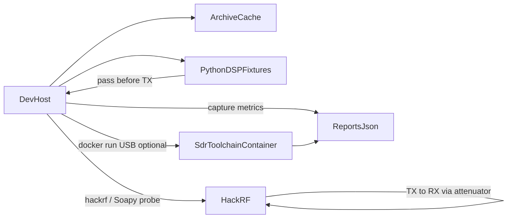

# rad-lab

Containerized SDR toolset and host-gated hardware-in-the-loop (HIL) bring-up for RF and signal-processing labs. The workflow follows the staged pattern used in [fpga-kit](https://github.com/fractalclockwork/fpga-kit): one board at a time, JSON stage records, a local docs archive, and a Docker toolchain image.

**First board:** HackRF One. Later boards stay closed until the HackRF `image` stage passes.

## Architecture



The **dev-host** runs `make stage` and owns USB probing and HIL checks. The **container** holds a reproducible SoapySDR / HackRF / Python DSP environment. Prefer host `hackrf_info` / Soapy when installed; fall back to a privileged USB helper container when needed.

## Stages

| Stage | Evidence | Must not |
| --- | --- | --- |
| `present` | USB + `hackrf_info` / Soapy probe | TX |
| `workflow` | Device opens; TX limits recorded; loopback env noted | Sustained TX |
| `image` | DSP fixture + attenuated TX↔RX tone; `hil.jsonl` / JUnit | Antenna TX without `HIL_LOOPBACK=1` |

## Safety

- Image stage **requires** `HIL_LOOPBACK=1` (operator asserts SMA cable through an attenuator, TX→RX).
- Board YAML caps `txvga_db`, `max_tx_db`, and `max_tx_ms`.
- Default center is 915 MHz for **cable loopback only**. Do not radiate from an antenna under this automation.
- For offline CI, `RAD_LAB_HIL_SIM=1` runs a software loopback path (still needs the env flag for image).

## Quick start

```bash
python3 -m venv .venv
.venv/bin/pip install -r requirements.txt
make archive
make image          # builds rad-lab-sdr (HackRF tools 2026.01.3)
make check          # pytest + software fixture

# Firmware (SPI) — operator must confirm the DUT first:
export HIL_FIRMWARE=1
make firmware BOARD=hackrf
# RESET the HackRF, then verify:
make firmware BOARD=hackrf

# With HackRF on USB and attenuator path wired:
export HIL_LOOPBACK=1
make stage BOARD=hackrf STAGE=present
make stage BOARD=hackrf STAGE=workflow
make hil BOARD=hackrf
```

## Boards

| Board | Docs | Bring-up |
| --- | --- | --- |
| [HackRF One](docs/boards/hackrf.md) | GSG / hackrf.readthedocs.io | First target |
| [ADALM-PLUTO](docs/boards/pluto.md) | Analog Devices | After HackRF image |

Supporting hardware (amps, splitters, analyzers, [FL2000 USB-VGA DAC](docs/boards/fl2000.md), Baofeng UV-5R+PLUS) is cataloged in docs as accessories until a clear probe exists.

## Documentation

- [docs/README.md](docs/README.md) — index
- [docs/pipeline.md](docs/pipeline.md) — stages, container, env vars
- [docs/reports.md](docs/reports.md) — JSON / JUnit contracts
- [docs/learn/](docs/learn/README.md) — lessons
- [AGENTS.md](AGENTS.md) — agentic HIL rules

## Dev boards (roadmap)

- HackRF One
- ADALM-PLUTO
- Supporting HW: chip frequency generators, amplifiers, circulators/splitters/mixers, spectrum analyzer, network analyzer
- USB-VGA DAC ([FL2000 / osmo-fl2k](docs/boards/fl2000.md); baseband TX ~DC–50 MHz; not FM-BCB/VHF)
- Baofeng UV-5R+PLUS
