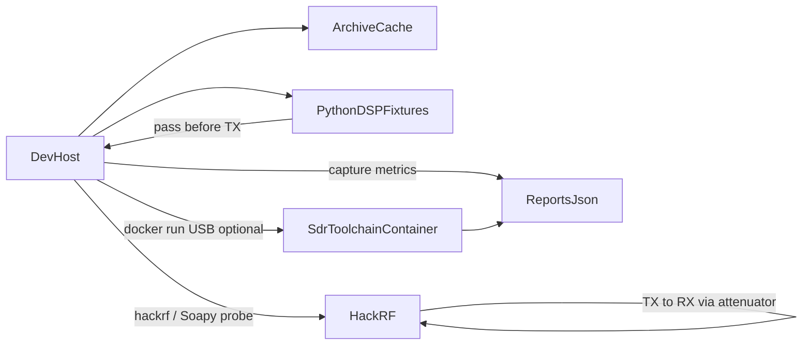

# rad-lab

Containerized SDR toolset with two workflows:

1. **[HIL bring-up](hil/)** — validate tooling, each DUT’s RX/TX path, then HackRF↔Pluto crossboard CW.
2. **[Lesson development](learn/)** — tutorials that start only after HIL bring-up is complete.

Shared: Docker toolchain (`make image`), docs/SDK archive (`make archive`), and `reports/` at the repo root.

## Workflow A — HIL bring-up

Finish the checklist in [`hil/README.md`](hil/README.md):

1. Tooling — archive, container, firmware, staged `present` → `workflow` → same-board `image`
2. RX/TX per DUT — Baofeng 2 m bootstrap (HackRF + Pluto)
3. Cross-board CW — 915 MHz HackRF↔Pluto

```bash
python3 -m venv .venv
.venv/bin/pip install -r requirements.txt
make archive
make image          # builds rad-lab-sdr (HackRF tools 2026.01.3)
make check

export HIL_FIRMWARE=1
make firmware BOARD=hackrf   # SPI; then RESET and re-run to verify
# After HackRF image pass:
make firmware BOARD=pluto    # mass-storage pluto.frm → v0.39

export HIL_LOOPBACK=1
make stage BOARD=hackrf STAGE=present
make stage BOARD=hackrf STAGE=workflow
make hil BOARD=hackrf
```

Board pages: [HackRF](hil/docs/boards/hackrf.md), [Pluto](hil/docs/boards/pluto.md), [accessories](hil/docs/boards/accessories.md). Agentic rules: [`hil/AGENTS.md`](hil/AGENTS.md) (root [`AGENTS.md`](AGENTS.md) points there).

## Workflow B — Lesson development

Start only after the HIL checklist is green. See [`learn/README.md`](learn/README.md). Today: [sampling and IQ](learn/lessons/01-sampling-and-iq.md).

## Architecture



The **dev-host** runs `make stage` and owns USB probing and HIL checks. The **container** holds a reproducible SoapySDR / HackRF / Python DSP environment.

## Safety

- Image stage and TX bring-up labs **require** `HIL_LOOPBACK=1` (operator asserts SMA cable through an attenuator).
- Board YAML under `hil/boards/` caps `txvga_db`, `max_tx_db`, and `max_tx_ms`.
- Default 915 MHz center is for **cable loopback only**. Do not radiate from an antenna under this automation.
- Offline CI: `RAD_LAB_HIL_SIM=1` (still needs the loopback env flag for image).

## Documentation map

| Tree | Contents |
| --- | --- |
| [`hil/`](hil/README.md) | Boards, stages, bring-up guides, bring-up labs, AGENTS |
| [`learn/`](learn/README.md) | Tutorials after HIL |
| [`archive/`](archive/README.md) | Cached manuals and SDKs |
| [`docker/`](docker/sdr/) | `rad-lab-sdr` image |
