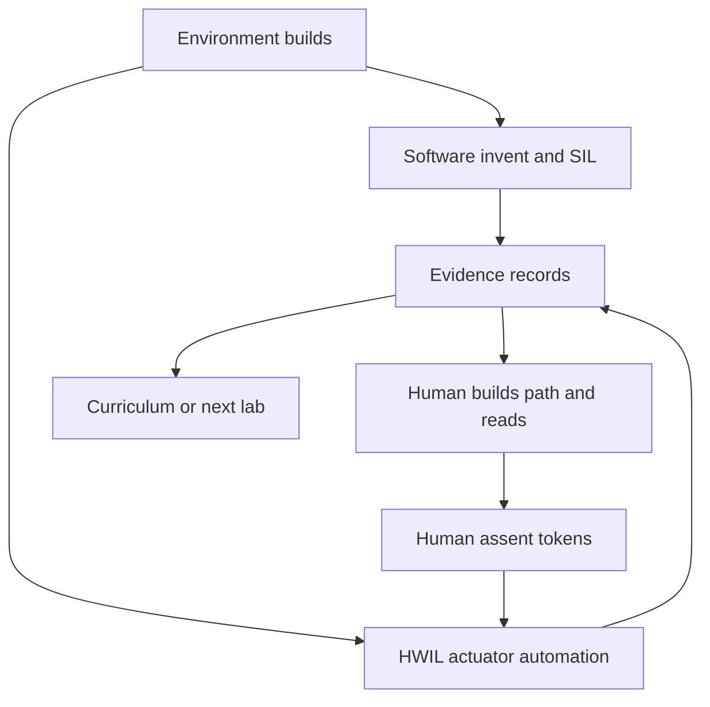

# Evidence-gated roles for agentic cyber-physical engineering

Software teams increasingly close loops with agents: invent a change, run tests, merge when green. That pattern fails when the work crosses into the physical world. An agent can invent a passing unit test; it cannot invent a cable, a licensed callsign, or a safe power setting without lying. This manifesto states a method for structuring repositories and agent workflows so that **digital steps may close autonomously** while **physical steps require a human who builds and adjusts the environment**—with machine-readable evidence and human-readable reporting as the handoff.

Formal definitions, equations, and glossary: [Evidence-gated roles](evidence-gated-roles.md).

The method is domain-agnostic. Radio bring-up is one case study; the same shape applies to robotics benches, instrumented labs, embedded flashing, and other actuator work.

## Terminology

| Term | Meaning |
| --- | --- |
| **HWIL** | **Hardware-in-the-loop** — physical DUT/actuator execution under a test harness |
| **human** / **human-in-the-loop** | Operator role; always spelled out (`HUMAN_*` assent tokens) |
| **SIL** | Simulation-in-the-loop / offline simulation on the fidelity ladder |

Keep `human` / `HUMAN_*` for the operator role and `HWIL` for hardware-in-the-loop so who may assent and who may energize never blur together.

## The problem

Continuous integration is a complete authority for pure software: the environment is virtual and fully under the pipeline’s control. **AI-native validation**—agents inventing and verifying until checks pass—is appropriate there.

Physical systems break that assumption. Someone must place the device, choose the path (conducted cable versus antenna), attest identity, and stay within power and regulatory policy. Failures often require changing the room: rewiring, swapping an attenuator, reseating USB, lowering gain. An agent that only retries the same command does not repair the bench. Worse, an agent that sets “operator confirmed” flags or types `YES` forges the only control that keeps automation from energizing hardware unsafely or illegally.

Readable documentation is part of that control. Assent without a scannable account of what ran, what passed, and what to do next asks a human to rubber-stamp a black box.

## Core claim

Structure the project by **who is allowed to act**, not by workflow letter or folder fashion.

Cross-role handoff has two layers:

1. **Evidence** — machine-readable records (JSON, JUnit, metrics) that unlock the next automated or curricular step.
2. **Writeup** — human-facing prose (and plots) that make judgment possible before assent.

Agents may invent freely inside roles that cannot harm the physical world. They must not invent assent, identity, or power policy. HWIL automation may measure and score within encoded ceilings; it must not raise those ceilings to make a test green.

## Two loops

**Autonomous loop (AI-native, including SIL).** Invent analysis, fixtures, or toolchain changes; measure in simulation or offline; write evidence. No USB keying, no operator prompt. Success is CI-green.

**Physical loop (human constructs; HWIL measures).** A person constructs or adjusts the environment; HWIL automation probes and measures within policy; evidence and a readable summary are written; the person judges; assent unlocks the next energize or flash. Success is not “the agent was clever”—it is “the bench matched the claim and the numbers agree.”

These loops share evidence. They do not share permission. A green SIL run does not imply permission to transmit. A passed low-power conducted HWIL stage does not invent a callsign for an on-air ID burst.

## Role pattern

Names vary by domain; the permission model does not. See the taxonomy in [evidence-gated-roles.md](evidence-gated-roles.md).

| Role | Question | May invent? |
| --- | --- | --- |
| **Human** (human-in-the-loop) | Is the operator present, and has the physical path and policy been attested? | Never assent, identity, or “path is connected” |
| **Actuator automation** (HWIL) | Does the device and path work under policy? | Only after assent and prior evidence |
| **Software** | Does the math / analysis work offline (SIL)? | Freely |
| **Environment** | Is the toolchain and host boundary correct? | Freely for builds; never for energize policy |
| **Consumer** (lessons, higher labs) | What comes next? | Content only; unlocked by evidence |
| **Harness** | What paths and unlock predicates exist? | Paths and predicates only—no prompts, no TX |

## Policy gates in scope

Two operator-owned claims belong in the method today:

- **License / identity** — who may transmit, identify, or operate under regulation. The human supplies identity; automation checks presence and shape.
- **Power / duration ceilings** — how hard and how long automation may energize. Encoded in manifests; fail-closed clamps; not agent-tunable.

Injury and high-energy hazard taxonomies are **out of scope** for this manifesto’s claims; the same role and evidence pattern can extend there later.

## Prior art

- Classical **hardware-in-the-loop (HIL)** test executives.
- **SIL → HIL** (and related) fidelity ladders.
- **Sim-to-real** in robotics, with human-supervised deployment.
- **ATE** lines where an operator loads a fixture, then automation scores.
- **Design controls / V&V** evidence packs and lab notebooks.

What this method emphasizes for **agentic** development: **assent must be non-forgeable by agents**, and **evidence is the only unlock token across roles**. Classical HIL assumed a human test engineer. Agent workflows need that assumption encoded in trees, imports, env tokens, and refusals that print the next human command.

## Case study: rad-lab

[rad-lab](../../README.md) instantiates the pattern for containerized SDR bring-up and curriculum:

| Method role | Tree |
| --- | --- |
| Human (human-in-the-loop) | [`human/`](../../human/) — assent tokens (`HUMAN_*`), type `YES` |
| Actuator automation (HWIL) | [`hardware/`](../../hardware/) — stages, firmware, RF labs; `make stage` / `make hwil` |
| Software (SIL) | [`software/`](../../software/) — fixture and DSP; `make sim` / `make check` |
| Environment | [`environment/`](../../environment/) — archive and container; `make image` |
| Consumer | [`lesson/`](../../lesson/) — unlocked by stage evidence |
| Harness | [`harness/`](../../harness/) — board YAML paths and `ready` predicates |

Evidence lives under `reports/` (for example `reports/<board>/stage.json`). Board YAML caps `max_tx_db` and `max_tx_ms`. On-air ID labs require an explicit callsign. Agents follow [`AGENTS.md`](../../AGENTS.md): one role at a time; never invent assent or type `YES`.

Gaps (notably consistent human-readable run writeups beside every JSON report) are in [checklist.md](checklist.md).

## Failure modes

- Assent without a readable summary of pass/fail, limits, and next steps.
- Agents exporting assent env vars or typing `YES` on the operator’s behalf.
- Raising power or duration ceilings to force a green stage.
- Curriculum that imports actuator transmit paths and skips evidence gates.
- A single orchestrator that both prompts the human and keys the transmitter.
- Treating SIL success as permission to energize.
- Using `HIL` to mean human-in-the-loop so hardware-in-the-loop (`HWIL`) and human assent (`HUMAN_*`) blur together.

## What to do next

Use the [instantiation checklist](checklist.md). Keep role rules short and local; keep [evidence-gated-roles.md](evidence-gated-roles.md) as the formal reference.
