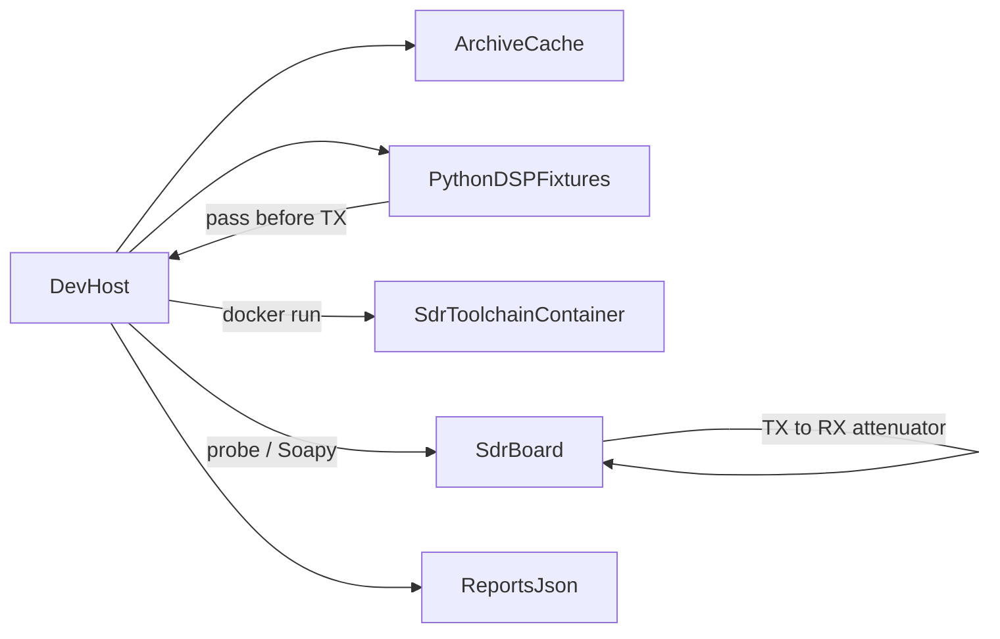

# Pipeline

The dev-host decides when a board is allowed to move. The `rad-lab-sdr` container holds SoapySDR, HackRF tools, and Python DSP. USB probing prefers host binaries; a privileged Docker helper with `/dev/bus/usb` is the fallback when host tools are missing.



## Make targets

| Target | What it does |
| --- | --- |
| `make archive` | Fetch public files in `archive/manifest.yaml` |
| `make image` | `docker build` the `rad-lab-sdr` image |
| `make archive-image` | `docker save` that image into the cache |
| `make sim BOARD=<id>` | Software DSP fixture only |
| `make stage BOARD=<id> STAGE=<name>` | One of `present`, `workflow`, `image` |
| `make hil BOARD=<id>` | The `image` stage |
| `make firmware BOARD=hackrf` | SPI-flash / verify firmware (`HIL_FIRMWARE=1` to write) |
| `make firmware BOARD=pluto` | Mass-storage / verify Pluto firmware (`HIL_FIRMWARE=1` to write) |
| `make check` | pytest, then `make sim` for `hackrf` |

`BOARD` defaults to `hackrf`. `STAGE` defaults to `present`.

## Stages

A stage writes `reports/<board>/stage.json`. The next stage on that board does not run until the previous record is `status: pass`.

| Stage | Evidence | Does not |
| --- | --- | --- |
| `present` | `lsusb` match and `hackrf_info` or Soapy probe | Open TX |
| `workflow` | Device opens (Soapy or CLI re-probe); TX limits recorded; `HIL_LOOPBACK` state noted | Sustained TX |
| `image` | Fixture pass; short TX; RX tone SNR ≥ `min_snr_db`; `hil.jsonl` + JUnit | Antenna TX without loopback flag |

Board order is fixed: `hackrf`, then `pluto`. Any stage on a later board is refused until `reports/hackrf/stage.json` shows `image` as `pass`.

## What the image stage runs

1. `scripts/fixture.py` must pass (synthetic tone SNR).
2. If `RAD_LAB_HIL_SIM=1`, a software loopback path records metrics without RF.
3. Otherwise Soapy opens the board, transmits a short CW offset tone within `max_tx_db` / `max_tx_ms`, captures RX IQ, and measures SNR.
4. Results land in `reports/<board>/<timestamp>/` and update `stage.json`.

## Environment

| Variable | When |
| --- | --- |
| `HIL_LOOPBACK` | Must be `1` before `image`. Operator asserts attenuator/cable TX→RX |
| `HIL_FIRMWARE` | Must be `1` before firmware write. Operator asserts the correct HackRF or Pluto is on USB |
| `HACKRF_SERIAL` | Optional override of `expected_serial` in `boards/hackrf.yaml` |
| `PLUTO_SERIAL` | Optional override of `expected_serial` in `boards/pluto.yaml` |
| `RAD_LAB_HIL_SIM` | Set to `1` for software-only image stage (tests / no hardware) |

## Container

`docker/sdr/Dockerfile` is Ubuntu 24.04 with HackRF tools (release **2026.01.3**), SoapySDR HackRF module, **SoapyPlutoSDR** (built from source), `libiio-utils` / `python3-libiio`, `dfu-util`, and Python numpy/scipy. GNU Radio is omitted from the slim image.

Example USB helper (when host tools are absent):

```bash
docker run --rm --privileged \
  -v /dev/bus/usb:/dev/bus/usb \
  -v "$PWD":/work -w /work \
  rad-lab-sdr hackrf_info
```
